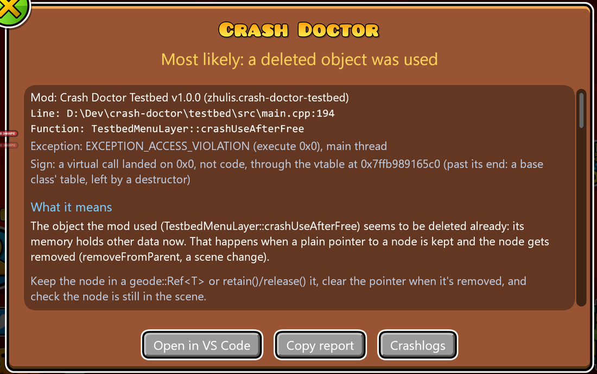

# Crash Doctor

[Русский](README.ru.md)

A [Geode](https://geode-sdk.org) mod for Geometry Dash: after a crash, the next start shows a report over the main menu that says **where** it crashed (the mod, the function, the file and line), **what most likely happened** in plain words, **how you got there** (the last scenes, popups, buttons and keys) and the log's last lines. Windows only.




## Install

Download `zhulis.crash-doctor.geode` from the newest of the [releases](https://github.com/ZhulinskiiDanil/crash-doctor/releases) and put it into Geode's mods folder (or **Install from file** on Geode's mods page). Or, with [Zhulis Mods Manager](https://github.com/ZhulinskiiDanil/zhulis-mods-manager), turn on its **Include pre-releases** setting: Crash Doctor is a beta, its releases are pre-releases.

## What it tells

Each diagnosis is a "most likely", with what it means and what to do. It's given only on signs that hold up: otherwise the report says there's no diagnosis and shows the facts.

| Diagnosis | The signs |
| --- | --- |
| Null pointer | An access violation at an address below 64 KB (Windows never maps it), with a mod on the stack. The advice is about checking what `getChildByID`, `typeinfo_cast` and `create()` return |
| Endless recursion | A stack overflow with one mod function filling the stack |
| A hook calls itself | The same, and the function is the mod's hook of that method (`this->onMoreGames(sender)` instead of `MenuLayer::onMoreGames(sender)`) |
| A deleted object used | A virtual call that landed outside code: the object's vtable pointer isn't one (its memory holds other data), or the slot is past the end of a base class' table, which is what a destructor leaves behind. Or the fill pattern of freed memory. The advice is about `Ref<>` and `retain()` |
| UI from another thread | A crash inside cocos2d on a thread a mod runs. The advice is `queueInMainThread` |
| Pure virtual call | The C runtime's `_purecall`: a method called on an object while it's destroyed |
| Uncaught C++ exception | Its type and `what()` |
| Division by zero | An integer division by zero in a mod's code |

The report also has the exception, the thread, **the source around the line** (when the file is on this computer), the stack (names, files and lines from the mods' PDBs: a mod built on your computer has one where it was built), up to 15 last actions, **the log by mod** (who logged what right before, warnings and errors counted), the log's last lines, **recent crashes** (the same crash counted, not listed again) and the versions.

**For players and for developers.** The whole report shows by itself when the crashed mod's PDB is on this computer: that's how its developer has it. Everyone else gets a short one: which mod it most likely was, that it's the mod's bug and not theirs, what to do, and the last actions, with **Details** a button away. The *Report detail* setting can make it always one or the other.

With [Improved Logger](https://github.com/ZhulinskiiDanil/improved-geode-logger) installed (optional), the last actions are pinned in its console as they happen, and a marker goes before the crash's report in the log.

- **Open in VS Code** opens the line (`vscode://file/...`)
- **Copy report** puts a short text on the clipboard for an issue or Discord: the diagnosis, the stack (a recursion folded), the last actions, GD, Geode and the versions of the mods on the stack. Your user folder in paths becomes `%USERPROFILE%`
- **Crashlogs** opens Geode's crashlog folder

For tools and scripts, the result is in Geode's log as one line of JSON:

```
crash-doctor-result {"diagnosis":"hook-recursion","culprit":"zhulis.crash-doctor-testbed","file":"D:\Dev\crash-doctor\testbed\src\main.cpp","line":138,"function":"TestbedMenuLayer::onMoreGames","hook":"MenuLayer::onMoreGames",...}
```

## Geode's crash handler stays

Geode's crash window and its crashlog work exactly as before. Crash Doctor's handler is in front of Geode's in the chain of unhandled exception filters: it writes what it needs and hands the crash to Geode's. A pure virtual call would end the game without either (the C runtime's `abort()`); Crash Doctor turns it into an exception, so Geode writes a crashlog for it too.

At the moment of the crash nothing allocates, locks, logs or touches cocos: everything goes into a file mapped into memory when the game started, which survives the process dying. The main thread keeps 128 KB of stack for the handlers after a stack overflow. Symbols, the analysis and the window come at the next start.

## Settings

| Setting | Default | |
| --- | --- | --- |
| Show the report | on | Off: the result goes only to the log |
| Report detail | Auto | Auto: the whole report when the crashed mod's PDB is here, a short one otherwise. Or always one of them |
| Language | Auto | Russian on a Russian Windows, English otherwise |

## Building

```sh
geode build
```

The parts without Geode (the analysis, the decoder, the crumbs, the report's text) have tests:

```sh
cmake -S tests -B build-tests
cmake --build build-tests
ctest --test-dir build-tests
```

`testbed/` is a separate mod that crashes the game on purpose, one kind at a time, and `testbed/check.sh <kind>` runs a whole check: crash, restart, the result line, a screenshot. It's never released. See [docs/ARCHITECTURE.md](docs/ARCHITECTURE.md) for how it all works.
