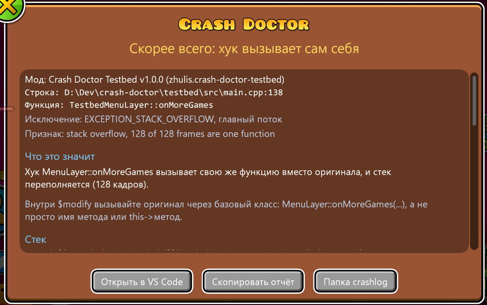

# Crash Doctor

[English](README.md)

Мод для [Geode](https://geode-sdk.org) и Geometry Dash: после краша при следующем запуске поверх главного меню появляется отчёт. В нём сказано, **где** упало (мод, функция, файл и строка), **что, скорее всего, случилось** простыми словами, **как вы туда попали** (последние сцены, попапы, кнопки и клавиши) и последние строки лога. Только Windows.




## Установка

Скачайте `zhulis.crash-doctor.geode` из последнего [релиза](https://github.com/ZhulinskiiDanil/crash-doctor/releases) и положите в папку модов Geode (или **Install from file** на странице модов Geode). Или через [Zhulis Mods Manager](https://github.com/ZhulinskiiDanil/zhulis-mods-manager) с включённой настройкой **Include pre-releases**: Crash Doctor пока бета, его релизы помечены как pre-release.

## Что он говорит

Каждый диагноз — «скорее всего», с объяснением и советом. Он ставится только по надёжным признакам; иначе отчёт честно говорит, что диагноза нет, и показывает факты.

| Диагноз | По каким признакам |
| --- | --- |
| Обращение через nullptr | Access violation по адресу ниже 64 КБ (Windows их никогда не выделяет), в стеке есть мод. Совет: проверять результат `getChildByID`, `typeinfo_cast`, `create()` |
| Бесконечная рекурсия | Переполнение стека, и стек заполнен одной функцией мода |
| Хук вызывает сам себя | То же, и эта функция — хук мода на этот метод (`this->onMoreGames(sender)` вместо `MenuLayer::onMoreGames(sender)`) |
| Обращение к удалённому объекту | Виртуальный вызов ушёл не в код: указатель на vtable — не vtable (память объекта занята другими данными) или слот за концом таблицы базового класса, которую оставляет деструктор. Или паттерн освобождённой памяти. Совет: `Ref<>`, `retain()` |
| UI из другого потока | Краш внутри cocos2d в потоке, который запустил мод. Совет: `queueInMainThread` |
| Pure virtual call | `_purecall` из C runtime: метод вызван у объекта во время удаления |
| Исключение C++ без обработки | Его тип и `what()` |
| Деление на ноль | Целочисленное деление на ноль в коде мода |

Ещё в отчёте: исключение, поток, **кусок исходника вокруг строки** (если файл есть на этом компьютере), стек (имена, файлы и строки из PDB модов: у мода, собранного на вашем компьютере, PDB лежит там, где его собрали), до 15 последних действий, **лог по модам** (кто что писал прямо перед крашем, с числом предупреждений и ошибок), последние строки лога, **недавние краши** (одинаковые считаются, а не повторяются) и версии.

**Для игроков и для разработчиков.** Полный отчёт показывается сам, если PDB упавшего мода есть на этом компьютере — так бывает у его разработчика. Остальные видят короткий: какой мод, скорее всего, виноват, что это ошибка мода, а не их, что делать, и последние действия; полный отчёт — по кнопке **Подробнее**. Настройка *Report detail* может сделать отчёт всегда полным или всегда коротким.

Кнопки:

- **Открыть в VS Code** — открывает строку (`vscode://file/...`)
- **Скопировать отчёт** — короткий текст для issue или Discord: диагноз, стек (рекурсия свёрнута), код, последние действия, версии GD, Geode и модов из стека. Папка пользователя в путях заменяется на `%USERPROFILE%`
- **Папка crashlog** — папка crashlog Geode

С [Improved Logger](https://github.com/ZhulinskiiDanil/improved-geode-logger) (необязательно) последние действия закреплены в его консоли, а перед отчётом о краше в логе ставится маркер.

Для инструментов результат пишется в лог Geode одной строкой JSON: `crash-doctor-result {"diagnosis":"hook-recursion","culprit":"...","file":"...","line":138,...}`.

## Обработчик Geode остаётся

Окно краша Geode и его crashlog работают как раньше. Обработчик Crash Doctor стоит в цепочке перед обработчиком Geode: записывает своё и передаёт краш дальше. Pure virtual call без мода закрывал бы игру через `abort()` мимо обоих; Crash Doctor превращает его в исключение, и Geode пишет crashlog и для него.

В момент краша ничего не выделяет память, не берёт блокировок, не пишет в лог и не трогает cocos: всё записывается в файл, отображённый в память при старте игры, который переживает падение процесса. Главный поток держит 128 КБ стека для обработчиков после переполнения стека. Символы, анализ и окно — при следующем запуске.

## Сборка

```sh
geode build
cmake -S tests -B build-tests && cmake --build build-tests && ctest --test-dir build-tests
```

`testbed/` — отдельный мод, который намеренно крашит игру, по одному виду за раз; `testbed/check.sh <вид>` проводит всю проверку: краш, перезапуск, строка результата, скриншот. Он никогда не публикуется. Как всё устроено — в [docs/ARCHITECTURE.md](docs/ARCHITECTURE.md).
